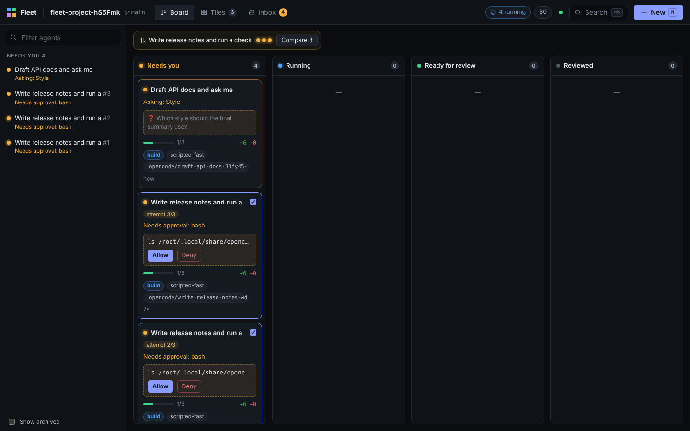
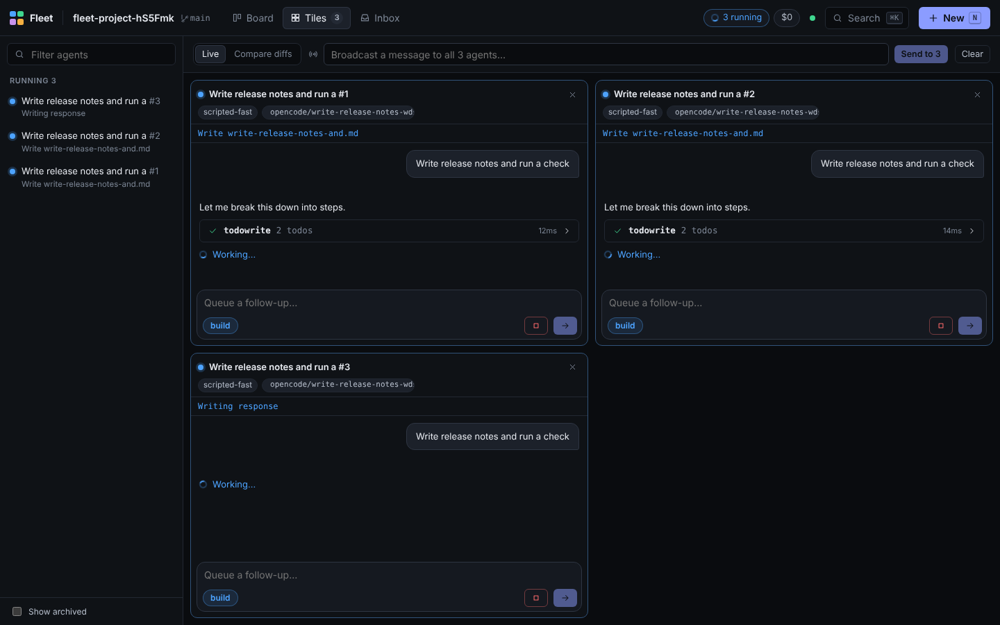
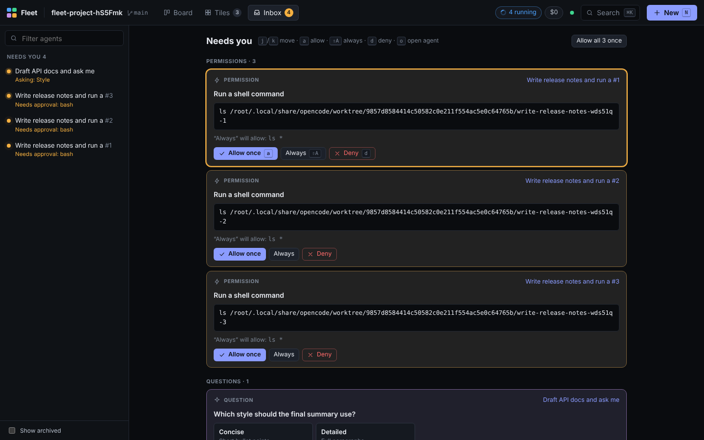
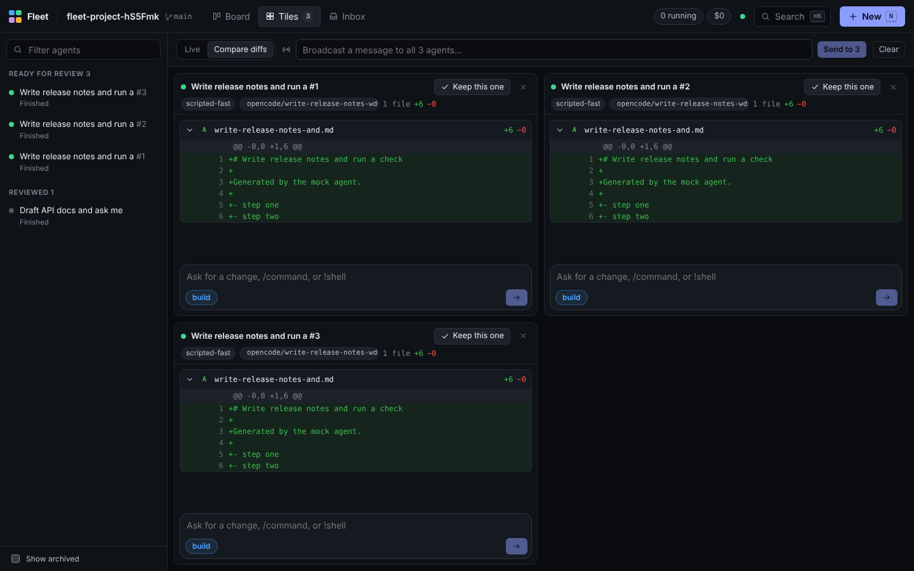
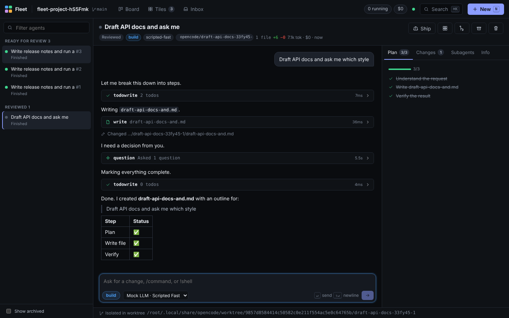
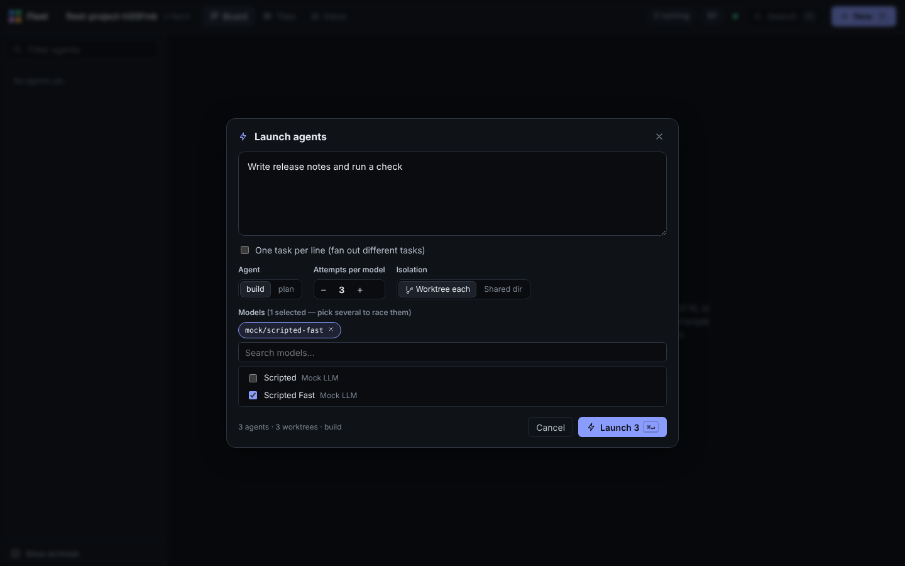

# OpenCode Fleet

A multi-agent command center for [OpenCode](https://opencode.ai). Launch many agents at once, watch them work side by side, unblock them from a single inbox, and pick the best result.



Fleet is a web UI that runs on top of `opencode serve`. It uses OpenCode's own HTTP API and event stream, so your existing config, providers, agents, MCP servers and permissions all keep working. Nothing is reimplemented.

## Quick start

```bash
npm install
npm run build
node server/fleet.mjs --dir ~/code/my-project      # starts `opencode serve` for you
# or attach to a server you already run:
node server/fleet.mjs --opencode http://127.0.0.1:4096
```

Open http://127.0.0.1:4700. You need `opencode` on your `PATH` (`npm i -g opencode-ai`), or pass `--opencode-bin`. If your server sets `OPENCODE_SERVER_PASSWORD`, export the same variable and Fleet's proxy forwards it as basic auth.

## What it borrows, and from where

Fleet takes the multi-agent ideas that work well in other tools and builds them on OpenCode's open server:

| Idea                                                                                                    | Seen in                                     | In Fleet                                                                                                          |
| ------------------------------------------------------------------------------------------------------- | ------------------------------------------- | ----------------------------------------------------------------------------------------------------------------- |
| **Best-of-N attempts.** Run one task several times, or across several models, then keep the best result | Codex cloud tasks                           | Launcher: _attempts per model_ × _models_. Compare diffs side by side, then **Keep this one**                     |
| **One git worktree per agent**, so parallel agents never edit the same checkout                         | Conductor, Crystal, Claude Squad, Codex app | _Worktree each_ isolation using OpenCode's `/experimental/worktree`. Branch shown on every card                   |
| **Inline permission prompts** and plan/build mode switching                                             | Claude Code, OpenCode TUI                   | Approve, always-allow or deny inline, on the board card, or in the inbox. **Tab** cycles agents                   |
| **A unified inbox** for everything that's blocked                                                       | Agent dashboards                            | Every agent's permissions, questions and errors in one queue. `a` / `⇧A` / `d` / `j` / `k`                        |
| **Live todo/plan tracking**                                                                             | Claude Code, OpenCode                       | Plan tab plus a progress bar on each card, both fed by `todo.updated` events                                      |
| **Tiled live view** of several sessions                                                                 | tmux-style agent runners                    | Tiles view with a broadcast bar that sends one message to every visible agent                                     |
| **Command palette**, `!shell` and `/commands` in the composer                                           | Claude Code, Cursor, VS Code                | `⌘K` / `Ctrl+K`. `!cmd` runs a shell command and `/name args` runs an OpenCode command                            |
| **Fork, revert and ship actions**                                                                       | OpenCode, Codex                             | Fork from any message, revert or restore turns, and Ship menu prompts (commit, run tests, open a PR, self-review) |

## Views

| Board: agents grouped by what they need from you  | Tiles: watch and steer several agents live    |
| ------------------------------------------------- | --------------------------------------------- |
|               |           |
| **Inbox: unblock the whole fleet from one place** | **Compare: diff the attempts, keep a winner** |
|               |       |
| **Agent: transcript, plan, changes, subagents**   | **Launcher: tasks × models × attempts**       |
|               |     |

- **Board** sorts agents into four columns: _Needs you_ (waiting on a permission or question, or hit an error), _Running_, _Ready for review_ (finished since you last looked) and _Reviewed_. Best-of-N groups get a strip at the top with a one-click **Compare**.
- **Tiles** shows the agents you pick (checkbox on any card) in a live grid. _Compare diffs_ swaps each transcript for its diff.
- **Inbox** lists every pending request across all agents and worktrees, newest last, and you can work through it from the keyboard.
- **Agent** shows the full transcript with streaming text, collapsible tool calls (edits rendered as diffs), reasoning, and subagent links. The side panel has the Plan, Changes (this agent / working tree / branch vs. default), Subagents and Info tabs.
- **Launcher** (`N`) takes a prompt, an agent (build/plan/custom), any number of models, 1–8 attempts per model, and worktree or shared isolation. _One task per line_ fans different tasks out to separate agents.

Fleet sends a desktop notification when an agent finishes or needs you while the tab is in the background. The tab title also shows how many agents need attention.

### Keyboard

| Key                                 | Action                                              |
| ----------------------------------- | --------------------------------------------------- |
| `N`                                 | Launch agents                                       |
| `B` / `T` / `I`                     | Board / Tiles / Inbox                               |
| `[` / `]`                           | Previous / next agent                               |
| `⌘K` / `Ctrl+K`                     | Command palette                                     |
| `Esc`                               | Stop the running agent (in composer); back to board |
| `Tab` (empty prompt)                | Cycle agent (build → plan → …)                      |
| Inbox: `j`/`k`, `a`, `⇧A`, `d`, `o` | Move, allow once, always allow, deny, open agent    |

## How it works

```
browser ──HTTP + SSE──▶ server/fleet.mjs ──proxy /oc/*──▶ opencode serve ──▶ one instance per directory (repo + each worktree)
```

- **One event stream for every worktree.** Fleet subscribes once to `GET /global/event`. Each event carries the directory it came from, so agents in different worktrees show up in one store.
- **Event-sourced state.** `src/state/reducer.ts` is a pure reducer over OpenCode events (`session.*`, `message.*`, `message.part.delta`, `todo.updated`, `permission.*`, `question.*`). Events are batched per animation frame, and components subscribe to narrow slices, so ten streaming agents don't re-render the whole app.
- **Snapshots merge with live events.** History fetched over REST is merged into live state instead of replacing it. Events that arrive while a fetch is in flight are kept, and after a reconnect the server snapshot wins.
- **Fleet metadata lives on the session.** Group, attempt and worktree are stored in OpenCode's `session.metadata.fleet`, so best-of-N groups survive reloads and other clients can see them.
- **The proxy has no dependencies.** `server/fleet.mjs` serves `dist/`, proxies `/oc/*` with SSE streaming intact, and can spawn `opencode serve` itself.

## Development

```bash
npm install
npm run harness                 # disposable git repo + mock LLM + real opencode serve on :4096
npm run dev                     # Vite on :4700, proxying /oc to :4096
npm test                        # reducer unit tests (replay a recorded real event stream)
npm run e2e                     # Playwright against a real opencode server
npm run typecheck && npm run format:check
```

### Testing against real OpenCode without API keys

`test/mock-llm/server.mjs` is a scripted, OpenAI-compatible endpoint. `test/harness.mjs` creates a throwaway git repo whose `opencode.json` points a `mock` provider at it, then starts the real `opencode serve`. Every prompt becomes a fixed plan that OpenCode actually executes:

- `todowrite`, then `write <slug>.md`, then a final `todowrite` and a markdown summary
- a `bash` call (and therefore a permission request) when the prompt says _run_, _test_ or _verify_
- a `question` call when the prompt says _ask_, _question_ or _choose_

The e2e suite (`e2e/fleet.spec.ts`) uses this to check the whole loop against genuine OpenCode events: it launches a best-of-3 in three worktrees, approves three permissions from the inbox keyboard, compares diffs, keeps a winner, answers a question, sends a follow-up, and navigates with the palette. The unit tests replay `test/fixtures/global-events.jsonl`, an event stream recorded from the same setup.

If Chromium is already installed (for example in a sandbox), point Playwright at it with `PLAYWRIGHT_CHROMIUM_PATH=/path/to/chrome npm run e2e`.

## Compatibility

Built and tested against **opencode 1.18.35** (`/doc` OpenAPI spec). It uses the stable v1 session, permission, question and event endpoints, plus `/experimental/session` (cross-directory listing) and `/experimental/worktree`. Without worktree support, use _Shared dir_ isolation.

## Project layout

```
server/fleet.mjs          zero-dep static server + OpenCode proxy + opencode launcher
src/api/                  typed OpenCode client (directory-aware) and schema subset
src/state/reducer.ts      pure event reducer + snapshot merge
src/state/derive.ts       phases, status lines, diff/cost aggregation
src/state/store.ts        zustand store: SSE ingestion, launch orchestration, actions
src/components/           Board, Tiles, Inbox, AgentView, Transcript, Launcher, Palette, …
test/                     mock LLM, harness, e2e bootstrap, recorded fixtures
e2e/                      Playwright specs
```
